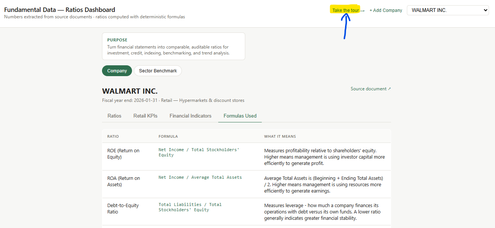
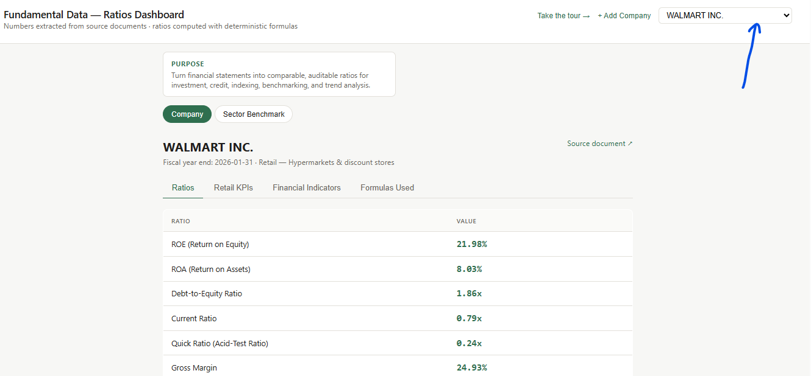
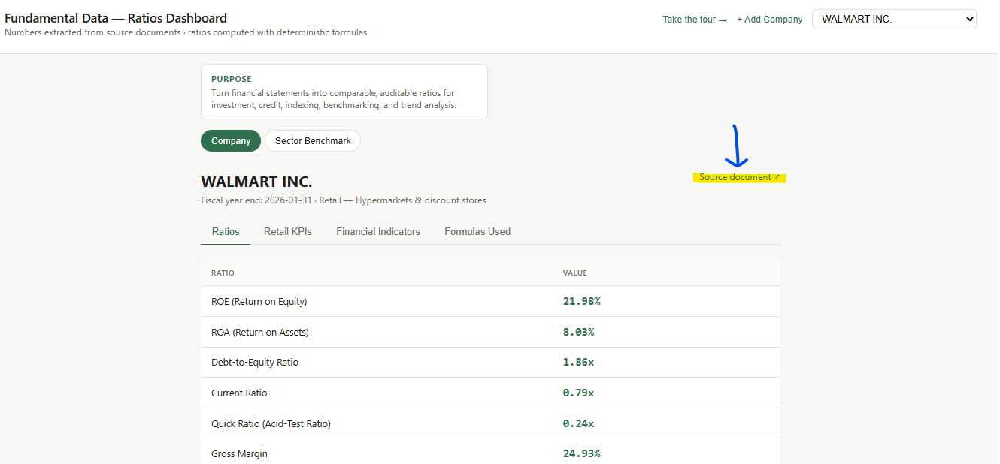
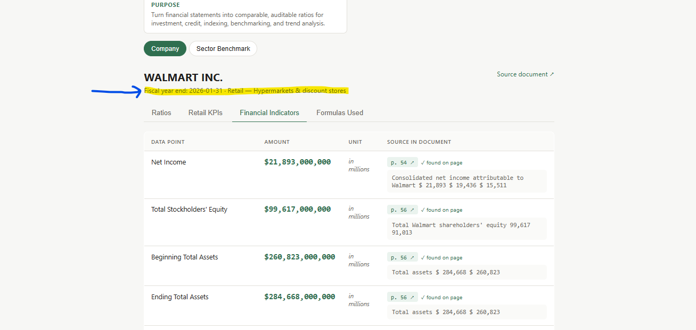
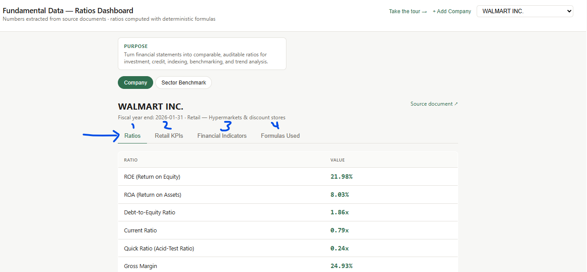
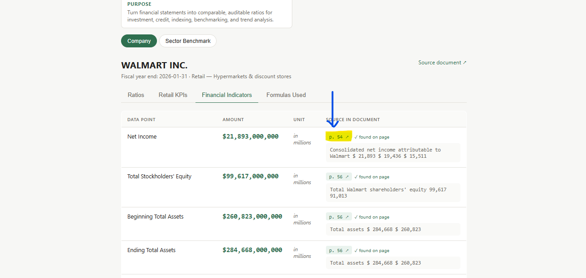
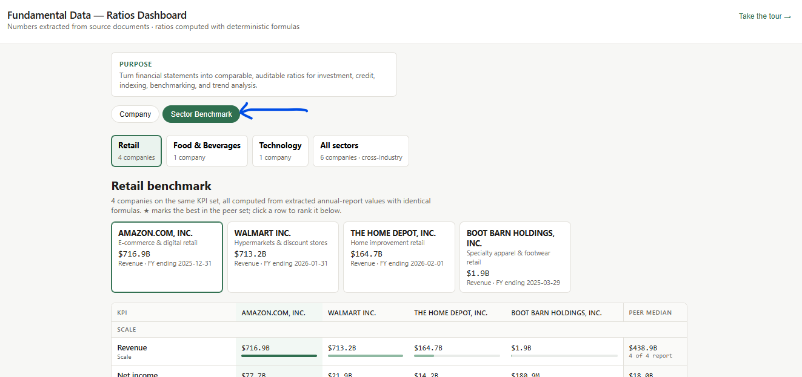

# Demo Script — LLM-Powered Financial Fundamentals

*Converting financial reports into comparable, auditable ratios and sector-specific performance indicators.*

**Demo page:** [`index.html`](index.html) · Live: <https://jivraj-18.github.io/temp/demos/fundamental-data/index.html>

> **How to read this document:** Part A is the background/pitch (read before the demo). Part B is the click-by-click demo with screenshots. Part C is the closing line and a one-page summary.

**Purpose:** Turn financial statements into comparable, auditable ratios for investment, credit, indexing, benchmarking and trend analysis.

---

## Part A — Background

### Executive summary

The solution uses a context-aware large language model (LLM) to identify and extract financial values from annual reports, 10-Ks, 10-Qs and other key company reports. It then normalizes the extracted data and uses a ratio engine to calculate general financial ratios, sector-specific ratios and key performance indicators (KPIs). Source-linked evidence and a human-in-the-loop quality layer support traceability and review, particularly where disclosures are ambiguous or require judgment.

The business value is a more scalable and consistent way to turn unstructured financial disclosures into standardized fundamental data for downstream analysis and decision-making.

### Why MSCI would need this

- **Scale financial data coverage** — process a broad range of issuers, report types and reporting periods.
- **Improve comparability** — normalize values and apply consistent calculation logic so ratios compare across companies and over time.
- **Enable richer analytics** — general ratios alongside sector-specific ratios and KPIs.
- **Strengthen transparency and auditability** — every extracted value links to its source location.
- **Balance automation with quality** — human review for complex, ambiguous or low-confidence cases.
- **Support multiple use cases** — structured inputs for investment research, credit analysis, indexing, benchmarking and trend analysis.

### The gap the app addresses

Financial information is published in reports that vary in format, terminology, structure, level of detail and sector-specific disclosure. Turning them into consistent analytical data takes substantial manual effort and interpretation.

| Common challenge | How the solution responds |
|---|---|
| Information is spread across long, differently structured reports. | LLM-powered extraction finds the relevant values in key financial reports. |
| Terms, units and presentation vary by issuer or report. | Financial data normalization gives a consistent analytical structure. |
| Ratios need repeatable formulas and sector context. | General and sector-specific ratios/KPIs are calculated with defined logic. |
| Analysts need to verify where a value came from. | Source-linked audit evidence supports traceability and review. |
| Complex or ambiguous disclosures need judgment. | A human-in-the-loop quality layer reviews and validates. |

### What the app does

| Capability | Description |
|---|---|
| LLM-powered financial extraction | Identifies financial values in annual reports, 10-Ks, 10-Qs and other key reports. |
| Context-aware interpretation | Uses report context to interpret disclosures and pick the value relevant to each metric. |
| Financial data normalization | Puts extracted data into a consistent format for calculation and comparison. |
| Ratio and KPI calculation | Calculates general ratios plus sector-specific ratios and KPIs using defined rules. |
| Source-linked audit trail | Connects each extracted value to its source evidence. |
| Human-in-the-loop validation | Routes complex, ambiguous or exception cases to human review. |

### Business value & USP

| Value driver | Value to MSCI |
|---|---|
| Efficiency and scalability | Less repetitive manual extraction; processing at greater scale. |
| Consistency and comparability | Normalization + defined formulas give consistent comparisons across issuers and periods. |
| Broader analytical depth | General ratios combined with sector-specific ratios and KPIs. |
| Transparency and trust | Source-linked evidence supports traceability, verification and audit. |
| Quality by design | Human review handles ambiguous disclosures and exceptions. |
| Reusable data foundation | Structured data that feeds investment, credit, indexing, benchmarking and trend analysis. |

**Core USP:** one integrated workflow — context-aware LLM extraction, financial normalization, automated ratio/KPI calculation, source-level traceability and human quality validation — rather than treating extraction as a standalone task.

---

## Part B — Live demo (8 steps)

### Step 1 — Open the application

Open <https://jivraj-18.github.io/temp/demos/fundamental-data/index.html>.

### Step 2 — Take the guided tour

Click **Take the tour** (top right) for a quick overview of the app, its key features and navigation.

### Step 3 — Select the issuer / company

Use the issuer dropdown in the upper-right corner to pick the company to explore.

### Step 4 — Open the source document

Click **Source document ↗** to open the original report the values were extracted from, so the audience can see the underlying disclosure.

### Step 5 — Review issuer details

Point out the issuer information shown under the company name (fiscal year end, sector, etc.).

### Step 6 — Explore the data sets

Click through the tabs:

- **Ratios** — commonly used ratios for evaluating performance and financial position.
- **Sector-specific KPIs** (e.g. *Retail KPIs*) — ratios tailored to the company's industry.
- **Financial Indicators** — the underlying values extracted from the source reports.
- **Formulas Used** — the exact formula behind every ratio.

### Step 7 — Review source annotations

Click a highlighted value to see it annotated in the source document. This traces the number straight back to its evidence.

### Step 8 — Explore sector benchmarks

Click **Sector Benchmark** to compare companies within a sector, or across sectors.

---

## Part C — Close & summary

### Closing line

> "This solution brings together financial data extraction, normalization, ratio calculation, source traceability and human quality validation in one workflow. It is designed to help MSCI scale the conversion of financial reports into consistent, auditable fundamentals that support deeper analysis and more efficient downstream use."

### One-page summary

**1. What you feed in (inputs)**

- **Regulatory filings:** SEC EDGAR, Companies House, SEDAR+
- **Financial reports:** annual and quarterly reports, financial statements, XBRL / iXBRL-tagged data
- **Company reference data:** identifiers, exchange and listing information
- **Market data:** stock prices, corporate actions, shares outstanding
- **Commercial data sources:** Bloomberg, FactSet, LSEG Data & Analytics, S&P Global Market Intelligence, Morningstar, Moody's Analytics

| Category | Supplier | Cost |
|---|---|---|
| Regulatory sources | SEC (EDGAR) | Free |
| | Companies House | Free |
| | SEDAR+ | Free |
| Stock exchanges | NYSE | Partially paid |
| | NASDAQ | Partially paid |
| | London Stock Exchange (LSE) | Partially paid |
| Commercial data vendors | Bloomberg | Paid |
| | FactSet | Paid |
| | LSEG Data & Analytics (Refinitiv) | Paid |
| | S&P Global Market Intelligence | Paid |
| | Morningstar | Paid |
| | Moody's Analytics | Paid |

**2. How it works (process)**

1. **Data collection** — retrieve filings and company information from the sources above.
2. **Data extraction** — pull financial statements, line items and disclosures with AI/LLM processing.
3. **Data normalization** — standardize across reporting formats, currencies, units and periods.
4. **Financial analysis** — calculate general and sector-specific ratios and KPIs.
5. **Validation & quality checks** — automated checks plus human review for accuracy, completeness and traceability.

**3. What comes out (outputs)**

- **Structured financial data** — fundamentals, line items, ratios and KPIs.
- **Source traceability** — jump from any value to its source document and supporting text.
- **Data access** — view and export structured outputs from the app.
- **Live demonstration** — select a company, review extracted data, inspect evidence, validate ratios and KPIs.

**Project objective:** transform financial reports into structured, standardized and traceable fundamental data through AI-powered extraction, financial analysis and human quality validation.
